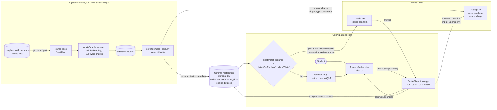

# ZenPharma Course Support Assistant — MVP

A lightweight RAG (Retrieval-Augmented Generation) assistant that answers Udemy
students' questions using the `zenpharma/documents` repo as its knowledge
source, so students aren't blocked waiting for a manual reply.

**Stack:** Claude API · Voyage AI embeddings · Chroma (local vector DB) ·
Python chunking/embedding scripts · FastAPI backend · single-page chat UI ·
Render/Railway (backend) + Vercel/Netlify (frontend)

---

## 1. Architecture

The system has two parts: an **offline ingestion pipeline** that turns the
course docs into a searchable vector store, and an **online query path** that
answers each student question from that store.



### How a question is answered

1. The chat UI sends `POST /ask` with `{"question": "..."}`.
2. FastAPI embeds the question with Voyage AI (`input_type="query"`).
3. Chroma returns the `TOP_K` (default 5) closest chunks and their cosine distances.
4. **Relevance gate:** if even the best chunk is farther than
   `RELEVANCE_MAX_DISTANCE` (default 0.6), Claude is **not** called and the
   student is sent to Udemy Q&A. This keeps answers grounded and saves cost.
5. Otherwise the chunks go to Claude with a system prompt that allows answers
   **only** from that context, and asks for the cause, numbered fix steps and the source.
6. The API returns `{"answer": ..., "sources": ["FILE.md#Section", ...]}`.

### Components

| Component | File | Role |
|---|---|---|
| Chunker | `scripts/chunk_docs.py` | Splits `.md`/`.txt` files by heading (ignoring `#` inside code fences), then into ≤500-word blocks; drops fragments under 30 words. Each chunk is prefixed with `[file > section]` so its embedding carries that context. |
| Embedder | `scripts/embed_docs.py` | Rebuilds the Chroma collection from scratch, embedding in batches. Can throttle itself to fit Voyage free-tier limits. |
| Vector store | `chroma_db/` | File-based Chroma collection `zenpharma_docs` (cosine). Ships alongside the backend. |
| Backend | `app/main.py` | FastAPI: `/health` (status + chunk count) and `/ask` (RAG pipeline above). CORS is controlled by `ALLOWED_ORIGINS`. |
| Frontend | `frontend/index.html` | Single static page, no build step. Renders code blocks safely and lists sources. |

---

## 2. Prerequisites

- Python 3.10+ (developed on 3.14)
- Git
- An [Anthropic API key](https://console.anthropic.com/)
- A [Voyage AI API key](https://www.voyageai.com/) for embeddings (a model key
  created in MongoDB Atlas also works)

---

## 3. Project structure

```
zenpharma-assistant/
├── .env                    # secrets + config (gitignored, never commit)
├── .env.example            # template: cp .env.example .env
├── .gitignore
├── README.md
├── scripts/
│   ├── requirements.txt    # Python dependencies
│   ├── chunk_docs.py       # splits source-docs into chunks
│   └── embed_docs.py       # embeds chunks into Chroma
├── source-docs/            # clone of zenpharma/documents
├── data/
│   └── chunks.jsonl        # generated chunk output
├── chroma_db/              # generated vector store
├── app/
│   └── main.py             # FastAPI backend
└── frontend/
    └── index.html          # one-page chat UI
```

Run every command below **from the project root** (`zenpharma-assistant/`).
The scripts use relative paths such as `data/` and `./chroma_db`.

---

## 4. Setup steps

### Step 1 — Get the project and the docs repo

```bash
cd zenpharma-assistant
git clone https://github.com/zenpharma/documents.git source-docs
```

### Step 2 — Create a virtual environment

```bash
python3 -m venv venv
source venv/bin/activate        # Windows: venv\Scripts\activate
```

### Step 3 — Install dependencies

```bash
pip install -r scripts/requirements.txt
```

This installs `anthropic`, `voyageai`, `chromadb`, `fastapi`, `uvicorn` and `python-dotenv`.

### Step 4 — Configure environment variables

Copy the template and fill in your keys (`.env` is gitignored, so keys never
reach GitHub):

```bash
cp .env.example .env
```

The minimum `.env` looks like:

```
ANTHROPIC_API_KEY=your_claude_api_key
VOYAGE_API_KEY=your_voyage_api_key
DOCS_PATH=./source-docs
CHROMA_PATH=./chroma_db
```

| Variable | Required | Default | Purpose |
|---|---|---|---|
| `ANTHROPIC_API_KEY` | yes | — | Claude API key |
| `ANTHROPIC_WORKSPACE_ID` | only if your key isn't scoped to a workspace | — | Sent as the `anthropic-workspace-id` header (`wrkspc_...`, from Console → Settings → Workspaces) |
| `VOYAGE_API_KEY` | yes | — | Voyage AI key (Voyage platform or MongoDB Atlas) |
| `DOCS_PATH` | no | `./source-docs` | Where the docs repo lives |
| `CHROMA_PATH` | no | `./chroma_db` | Where the vector store is written/read |
| `VOYAGE_MODEL` | no | `voyage-4-large` | Embedding model. Must be the same at embed time and query time. |
| `CLAUDE_MODEL` | no | `claude-sonnet-5` | Answer model; `claude-haiku-4-5` is cheaper |
| `TOP_K` | no | `5` | Chunks retrieved per question |
| `RELEVANCE_MAX_DISTANCE` | no | `0.6` | Relevance gate (see §6) |
| `ALLOWED_ORIGINS` | no | `*` | Comma-separated CORS origins; set to your frontend URL once deployed |
| `VOYAGE_TPM` / `VOYAGE_RPM` | no | off / `3` | Throttling for `embed_docs.py` on the Voyage free tier |

You do **not** need a MongoDB database. Chroma is the vector store.

### Step 5 — Chunk the docs

```bash
python scripts/chunk_docs.py
```

Produces `data/chunks.jsonl` (≈666 chunks from the current docs). Chunk IDs
look like `FILE.md::<section-index>::<heading>::<block>`, so headings that
repeat in the same file (e.g. "Say This" in DEMO-GUIDE.md) still get unique IDs.

### Step 6 — Generate embeddings and store them

With a payment method on your Voyage account (the free token allowance still applies):

```bash
python scripts/embed_docs.py
```

**On the Voyage free tier** (no payment method: 3 requests/min, 10K tokens/min),
turn on throttling. The script sizes each batch to the token budget, waits
between requests and retries on rate-limit errors. Expect ~20–25 minutes:

```bash
VOYAGE_TPM=10000 VOYAGE_RPM=3 python scripts/embed_docs.py
```

The script clears the collection and rebuilds it every run, so re-running after a failure is safe.

### Step 7 — Run the backend

```bash
uvicorn app.main:app --reload --port 8000
```

- `--reload` watches `.py` files only. **Restart uvicorn after changing `.env`
  or re-embedding.**
- Check it's up: open http://localhost:8000/health, which should return
  `{"status":"ok","chunks":666}`.
- Opening `/ask` in a browser returns **405 Method Not Allowed**. That's
  expected, since `/ask` only accepts POST.

Test a question:

```bash
curl -X POST http://localhost:8000/ask \
  -H "Content-Type: application/json" \
  -d '{"question": "My pod is in CrashLoopBackOff in Module 4, what should I check?"}'
```

Response shape:

```json
{
  "answer": "...",
  "sources": ["SETUP-GUIDE.md#Pod in `CrashLoopBackOff`", "..."]
}
```

### Step 8 — Run the frontend

Open `frontend/index.html` directly in a browser, or serve it:

```bash
cd frontend
python3 -m http.server 3000     # then open http://localhost:3000
```

`API_URL` at the top of the script in `index.html` defaults to
`http://localhost:8000`. Change only that constant when you deploy.

---

## 5. Asking good questions

Retrieval is by meaning, but misspelled technical terms throw it off. For
example, "Crass loop back of a pod" scored 0.656 (just over the gate), while
"My pod is in CrashLoopBackOff in Module 4, what should I check?" scored 0.366.

- Spell error names as shown on screen: `CrashLoopBackOff`, `ImagePullBackOff`, `terraform apply`.
- Ask a full question and mention the module or lab.
- Paste the actual error message. It matches the troubleshooting docs closely.
- Stick to the course material. General questions ("what is Kubernetes?")
  that the docs don't cover get the Udemy Q&A fallback, and that's intended.

### Example prompts

These match topics that exist in `source-docs/`. Use them to try the assistant
or as templates for your own questions.

**Setup & prerequisites (Module 0, SETUP-GUIDE)**
- Which tools do I need to install before starting the course, and which Terraform version?
- How do I create the IAM user `terraform-user` and configure the AWS CLI with it?
- How do I create the S3 bucket for Terraform state?

**Terraform & GitHub Actions (Modules 1–2)**
- How do I set up passwordless GitHub authentication with SSH?
- My Terraform state is locked after a failed workflow run. How do I release the lock?
- How does the Terraform workflow decide when to run apply, and what safety gates does destroy have?
- Why does the plan job use `continue-on-error`?

**Cluster bootstrap (Module 3, RUNBOOK-RECREATE)**
- What do the bootstrap scripts install, and in what order do they run?
- How do I install the AWS Load Balancer Controller and ArgoCD manually?
- How do I configure kubectl for the EKS cluster after terraform apply?

**Docker & CI/CD (Modules 4 and 7)**
- How do I build and test the frontend Docker image locally?
- Which secrets does the frontend repository need, and how do I create the fine-grained PAT?
- What are the jobs in the frontend CI workflow and how do they depend on each other?
- How do the reusable `_java-build.yml` and `_node-build.yml` workflows work?

**GitOps, Helm & deploying (Modules 5–6)**
- What is the folder structure of the GitOps repository?
- What should I check before deploying pharma-ui to dev?
- How do I initialize the database schemas on RDS?
- My ExternalSecret is not syncing. What should I check?

**Environment promotion (Module 8)**
- How do I promote pharma-ui from dev to QA?
- Why do dev, QA and prod use different promotion models?

**Troubleshooting (paste your error)**
- My pod is in CrashLoopBackOff after deploying a backend service. What should I check?
- I'm getting ImagePullBackOff with a wrong image tag. How do I fix it?
- ArgoCD keeps reverting my manual `kubectl edit`. Why?
- How do I roll back a bad deployment using git revert?

**Runbooks & interview prep**
- What are the steps to destroy the cluster without leaving the ALB or ECR images behind?
- How does ingress traffic flow from the user to a service?
- How would you do an EKS upgrade?
- How do pods communicate with the database?

---

## 6. Tuning the relevance gate

`RELEVANCE_MAX_DISTANCE` is a cosine distance, where lower means more similar.

- **Too many fallback replies** to valid questions → raise it (try 0.65–0.7).
- **Off-topic questions getting answers** → lower it.

Tune it using real student questions, then restart uvicorn. Claude is still
told to say so when the retrieved context doesn't answer the question.

---

## 7. Deploying (once local testing works)

| Component | Where | Notes |
|---|---|---|
| Backend (FastAPI) | Render or Railway | Start command `uvicorn app.main:app --host 0.0.0.0 --port $PORT`; set the env vars from `.env` in the dashboard |
| Vector store | Ships with the backend | Chroma is file-based: build `chroma_db/` before deploying or at build time. Move to Supabase pgvector if you outgrow it. |
| Frontend | Vercel or Netlify | Set `API_URL` in `index.html` to the backend's public URL, and set `ALLOWED_ORIGINS` on the backend to the frontend URL |

---

## 8. Updating the knowledge base

Whenever `zenpharma/documents` changes:

```bash
cd source-docs && git pull && cd ..
python scripts/chunk_docs.py
python scripts/embed_docs.py        # add VOYAGE_TPM=10000 VOYAGE_RPM=3 on the free tier
```

Then restart the backend so it opens the rebuilt collection.

---

## 9. Troubleshooting

| Symptom | Cause | Fix |
|---|---|---|
| `voyageai.error.RateLimitError: ... reduced rate limits of 3 RPM and 10K TPM` | No payment method on the Voyage account | Add one (free tokens still apply), or run with `VOYAGE_TPM=10000 VOYAGE_RPM=3` |
| `chromadb.errors.DuplicateIDError` during embedding | Old `chunks.jsonl` built before section indexes were added to IDs | Re-run `python scripts/chunk_docs.py`, then embed again |
| `/ask` returns 500; log shows `anthropic-workspace-id header` error | API key isn't scoped to a workspace | Set `ANTHROPIC_WORKSPACE_ID` in `.env` (or use a workspace-scoped key) and restart uvicorn |
| Browser shows 405 on `/ask` | GET request to a POST-only endpoint | Use the chat UI or `curl -X POST` |
| Every answer is the "post on Udemy Q&A" fallback | Question didn't pass the relevance gate | See §5 and §6 |
| `An API key is required` from Voyage | `.env` not loaded | Run commands from the project root, where `.env` lives |
| `address already in use` on port 8000 | uvicorn already running | Stop the old one (Ctrl+C) or use another `--port` |

---

## 10. Guardrails

The system prompt in `app/main.py` instructs Claude to:
- Answer only from the retrieved chunks, never inventing commands, file names or settings
- Give the likely cause, then numbered fix steps with commands in code blocks
- Cite the source doc/section
- Point the student to Udemy Q&A when the context doesn't contain the answer

The relevance gate adds a second layer: weak matches never reach Claude.
Input is limited to 4,000 characters per question.

---

## 11. Build it yourself (practice guide)

Want to build this assistant yourself to learn RAG? Do the stages in order and
check each one before moving on. Each stage teaches one idea.

| Stage | What you build | What you learn | How to check it |
|---|---|---|---|
| 1. Accounts & keys | Anthropic key (+ workspace ID if needed), Voyage key | API auth, workspace-scoped keys | Keys are in `.env` |
| 2. Project skeleton | Folders from §3, venv, `pip install -r scripts/requirements.txt` | Python project setup | `python -c "import anthropic, voyageai, chromadb, fastapi"` runs cleanly |
| 3. Knowledge source | Clone the docs repo into `source-docs/` (or use any folder of your own `.md` files) | What RAG draws on | `ls source-docs/*.md` |
| 4. Chunking | `chunk_docs.py` | Splitting by heading, chunk size, unique IDs, adding context to each chunk | `data/chunks.jsonl` exists; `wc -l data/chunks.jsonl` shows a sensible count; every `id` is unique |
| 5. Embedding | `embed_docs.py` | Embeddings, `document` vs `query` input types, batching, rate limits | Script ends with "Collection 'zenpharma_docs' now holds N chunks" |
| 6. Retrieval test | Query Chroma directly (snippet below) | Cosine distance, top-K, choosing a relevance cut-off | Good questions score well under 0.6; off-topic ones score above it |
| 7. Backend | `app/main.py`: `/health` + `/ask` | Grounding prompt, relevance gate, returning sources | `/health` shows the chunk count; the curl in Step 7 returns an answer with sources |
| 8. Frontend | `frontend/index.html` | Calling the API from a browser, CORS | Ask a question in the page and see the answer and sources |
| 9. Evaluate & tune | Try the example prompts in §5 plus off-topic ones | Precision vs. recall trade-off | Adjust `RELEVANCE_MAX_DISTANCE` / `TOP_K` until good questions are answered and off-topic ones fall back |
| 10. Deploy (optional) | §7 | Env vars in the cloud, CORS origins | Public frontend answers questions |

**Retrieval test snippet (stage 6).** Run it from the project root to see what
the backend will retrieve, without calling Claude:

```python
# save as scripts/probe.py, run: python scripts/probe.py "your question"
import os, sys, chromadb, voyageai
from dotenv import load_dotenv

load_dotenv()
q = sys.argv[1]
emb = voyageai.Client().embed([q], model=os.getenv("VOYAGE_MODEL", "voyage-4-large"),
                              input_type="query").embeddings[0]
res = chromadb.PersistentClient(path=os.getenv("CHROMA_PATH", "./chroma_db")) \
    .get_collection("zenpharma_docs").query(query_embeddings=[emb], n_results=5)
for d, m in zip(res["distances"][0], res["metadatas"][0]):
    print(f"{d:.3f}  {m['source']} > {m['section']}")
```

**Exercises to go further**
- Change `MAX_WORDS` in `chunk_docs.py` (e.g. 250 vs. 800), re-chunk and
  re-embed, then compare distances for the same questions.
- Point `DOCS_PATH` at your own notes and build an assistant for them.
- Switch `CLAUDE_MODEL` to `claude-haiku-4-5` and compare answer quality and cost.
- Log questions that fell back (distance above the gate) to find gaps in the docs.
- Deliberately misspell a term ("Crass loop back") and watch the distance change.

**Common pitfalls you'll likely hit:** they're all in §9 (rate limits,
duplicate chunk IDs, workspace header, 405 on GET, `.env` not loaded).

---

## 12. Next steps after MVP validation

- Log unanswered/escalated questions to find doc gaps
- Add a "flag to instructor" button in the UI
- Consider migrating to Amazon Bedrock Knowledge Bases if traffic or
  reliability needs grow
